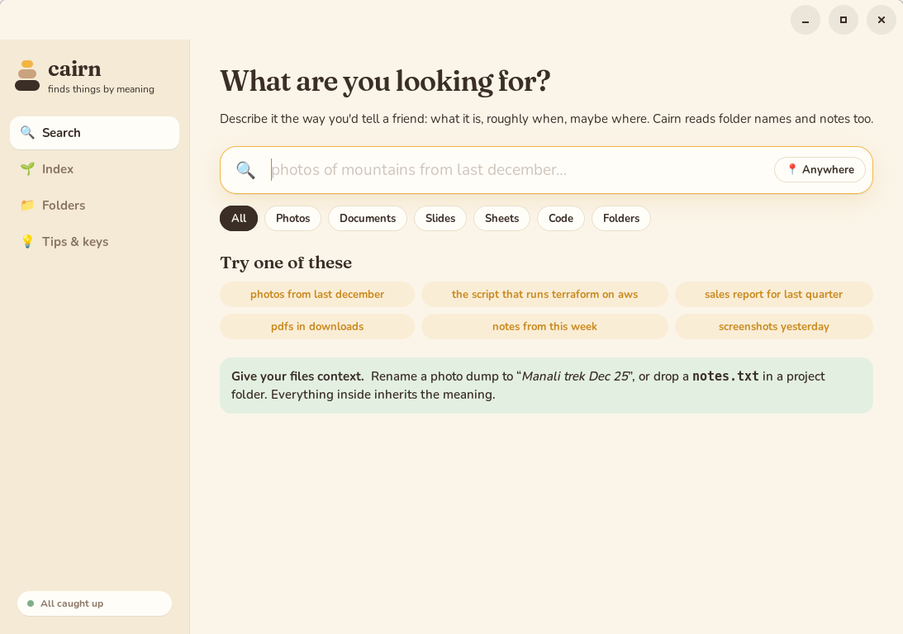
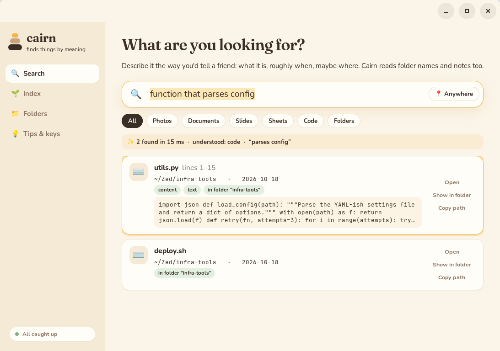
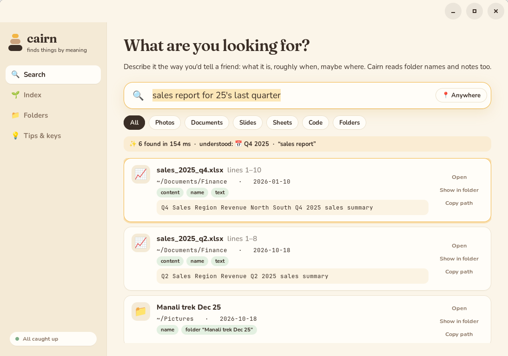
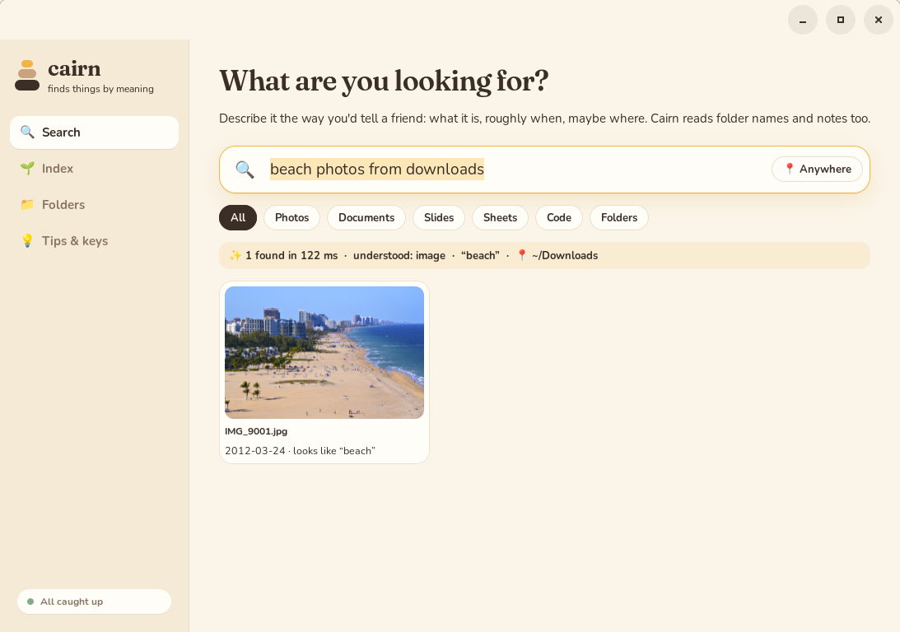
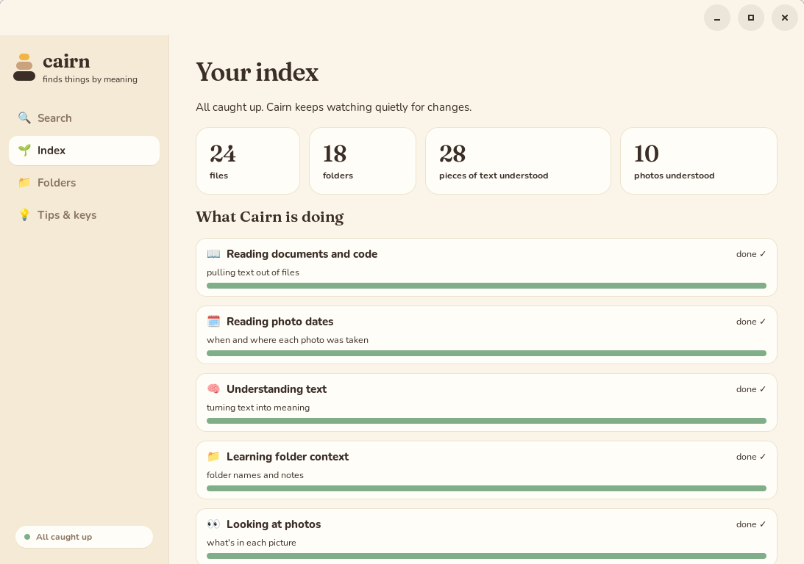
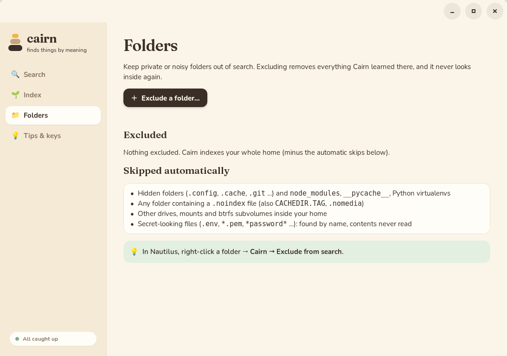

<div align="center">

# 🪨 Cairn

**Find anything on your Linux machine by describing it.**

*"photos of mountains from last december" · "the script that runs terraform on aws" · "sales report for 25's last quarter" · "fire photos from downloads"*

Local · private · offline · tiny models · never slows you down · never writes to your files


</div>

---

## What it is

Cairn is a natural-language file search for Linux desktops. You describe a file
the way you'd describe it to a friend, and Cairn finds it. That works for a photo
with no useful name, a function buried in a repo, or a report someone emailed you
last quarter.

It runs entirely on your computer. Two small open models (33M parameters for
text, 150M for images) run on the CPU. Nothing is uploaded, there is no account,
and there are no API keys. After a one-time model download it works fully
offline, even airgapped.

### The idea: context, not just content

Plain search fails on a badly organised file system, because a folder called
`IMG_dump` tells it nothing. Cairn gives meaning to what surrounds a file:

* **Folder names carry meaning.** Rename a folder to `Manali trek Dec 25`, and
  every photo inside becomes findable as "manali trek", "snow trip" or "photos
  from december".
* **Notes inside a folder describe everything in it.** Drop a `notes.txt` saying
  "client SOPs for Acme, 2026" into a project folder, and its files inherit that
  context.
* **Photos are understood by what's in them.** A context-free photo dump is still
  searchable: "dog pictures", "beach", "mountains".
* **Dates are understood the way people say them.** "last december", "25's last
  quarter", "two weeks ago", "yesterday". For photos, Cairn reads the capture time
  from EXIF; for other files it uses the earlier of created and modified, so a
  copied or edited file keeps its origin date.
* **Code is found to the line.** "function that parses config" returns
  `utils.py:1-15`, and Enter opens it in your editor at that line.
* **Places are understood.** "...from downloads", "...in my projects folder", or
  `--here` limit a search to that folder.

## Screenshots

| | |
|---|---|
|  |  |
| Ask in plain words | Code hits come with line ranges and snippets |
|  |  |
| "25's last quarter" is read as Q4 2025 | "from downloads" searches only `~/Downloads` |
|  |  |
| What Cairn knows and what it's learning | Keep folders out of search |

## Ways to use it

| Where | How |
|---|---|
| **The app** | Run `cairn`: search, index status, folders, tips. |
| **Your launcher** | Bind a key (e.g. <kbd>Super</kbd>+<kbd>/</kbd>) to `cairn launch --find`. Results open in fuzzel; arrow keys to move, Enter to open. See [Integrations](docs/INTEGRATIONS.md). |
| **Nautilus** | Right-click → *Search with Cairn…*, or *Cairn → Exclude from search*. |
| **Terminal** | `cairn search fire photos from downloads` (`--json` for scripts and AI agents). |

## Install

Short version for Debian/Ubuntu; other distros, offline installs and
uninstalling are in **[docs/INSTALL.md](docs/INSTALL.md)**.

```sh
sudo apt install build-essential pkg-config libgtk-4-dev poppler-utils curl
curl --proto '=https' -sSf https://sh.rustup.rs | sh     # if you don't have Rust 1.85+

git clone https://github.com/dedWalker18/cairn.git && cd cairn
./install.sh                              # builds; installs to ~/.local/bin + a systemd user unit
cairn models fetch                        # once: ~640 MB of model files, hash-verified
systemctl --user enable --now cairnd      # start indexing (idle priority)

sudo make -C nautilus install && nautilus -q   # optional: Nautilus menu
cairn                                     # open the app
```

The first index of a big home takes a while. Names and dates are searchable
within minutes. Meaning search for text fills in over hours of idle time, and
photos come after that. The **Index** page shows progress.

## Safety and privacy

Cairn was built for a work machine where losing data is not an option.

* **Your files are never written.** The kernel enforces it: the daemon locks
  itself with [Landlock](https://docs.kernel.org/userspace-api/landlock.html) so
  it can write only to its own data folder.
* **File parsers run in disposable sandboxed processes.** They cannot write
  anything, their memory is capped, and they are killed if they hang. A bad PDF
  cannot take Cairn down, let alone your system.
* **No network.** The daemon has no network code. Landlock denies TCP, and the
  systemd unit allows only Unix sockets.
* **Never in your way.** Indexing runs at idle CPU and I/O priority. It pauses
  on battery and under CPU, disk or memory pressure, and it avoids evicting your
  page cache.
* **Crash-safe.** A test kills the daemon 30 times at random points and checks
  that the index never corrupts and ends identical to a clean build.
* **Secrets stay secret.** `.env`, `*.pem`, `*password*` and similar files are
  findable by name, but their contents are never read.
* **Logs are bounded.** Logs go only to the system journal. Cairn writes no log
  files of its own.

Details: [docs/ARCHITECTURE.md](docs/ARCHITECTURE.md#safety-and-data-protection).

## How it works

```
cairnd (systemd user service)
 ├─ scanner     per-folder diff of your home, inotify watcher, rename/move tracking
 ├─ pipeline    durable jobs → sandboxed workers:
 │                extract   text from PDF/Office/code/markdown/CAD-text, EXIF dates
 │                embed     bge-small (text) + CLIP (images), idle priority
 ├─ index       SQLite (WAL) + full-text search + own crash-safe vector files
 └─ search      date/kind/place parser → vectors + keywords + folder context → ranked
cairn (CLI) · cairn-gui (app) · cairn launch (fuzzel) · Nautilus extension → Unix socket
```

* Written in **Rust**, plus a ~200-line **C** Nautilus extension.
* **No LLM.** Queries are parsed by a small grammar (dates, kinds, places), and the
  rest is embedded.
* Built with: candle, ONNX Runtime, SQLite FTS5, GTK 4, Landlock, inotify, tokenizers.
* Model details, including what we changed for speed:
  **[docs/MODELS.md](docs/MODELS.md)**.

## Documentation

| | |
|---|---|
| [INSTALL.md](docs/INSTALL.md) | Requirements, install, update, uninstall, troubleshooting |
| [INTEGRATIONS.md](docs/INTEGRATIONS.md) | fuzzel / niri / other launchers, Nautilus extension, scripts and AI agents |
| [MODELS.md](docs/MODELS.md) | The models, pinned hashes, and the changes made for speed |
| [AIRGAP.md](docs/AIRGAP.md) | Building and running with no network |
| [ARCHITECTURE.md](docs/ARCHITECTURE.md) | Design, storage, query path, roadmap |
| [DECISIONS.md](docs/DECISIONS.md) | Every engineering decision with its reasoning |
| [RESEARCH.md](docs/RESEARCH.md) | Prior art and the lessons taken from it |
| [SCENARIOS.md](docs/SCENARIOS.md) | Behaviours analysed and how each is tested |

## Status

Early but working: developed and run on a ~550k-file home (Ubuntu 24.04, btrfs, niri,
Nautilus 46). Known gaps and plans are in the [roadmap](docs/ARCHITECTURE.md#roadmap):
* HEIC/RAW photos, video content, OCR,
* `.gitignore` support,
* a GPU backend,
* a dark theme.

## Contributing

Issues and PRs are welcome. Before sending code:

```sh
cargo test --workspace
CAIRN_TEST_DIR=/tmp/cairn-test tests/behaviour.sh          # live behaviour checks
CAIRN_TEST_DIR=/tmp/cairn-test tests/chaos.sh 30           # crash-consistency (pipeline/storage changes)
make -C tests/nautilus run
```

Never point tests at your real home: `tests/env.sh` keeps everything in a scratch
folder. Record design decisions in [docs/DECISIONS.md](docs/DECISIONS.md).

## License

Apache-2.0. See [LICENSE](LICENSE) and [NOTICE](NOTICE) for third-party
components (fonts, vendored code, models).
